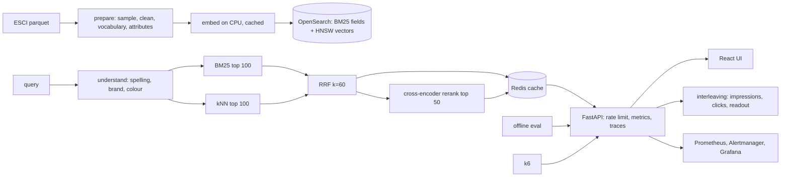

# Hybrid search service

Product search over a real public catalog: 200,000 US products from the Amazon Shopping Queries Dataset
(ESCI) indexed in OpenSearch with BM25 fields and HNSW vectors, fused by reciprocal rank fusion, with a
cross-encoder reranker, query understanding (spelling correction against the catalog, brand and colour
filters), a Redis cache, per-client rate limits, an SLO with an alert, k6 load tests, OpenTelemetry, and a
React UI. The ranking variants are evaluated offline with NDCG@10 and MRR@10 on human relevance labels, and
compared online-style with team-draft interleaving. Terraform for an Oracle Cloud free-tier VM; GitHub
Actions that index a small catalog and run the end-to-end test on every push.

**Status: built and verified locally (2026-10-17); not deployed.** Every number below comes from the
committed scripts on this machine (i7, 20 threads, CPU only for the models).

## Results

<!-- RESULTS -->
- **Catalog and labels:** 200,000 US products indexed (38,902 judged for the sample, the rest random distractors); 2,000 evaluation queries with 40,022 human judgments (E 17,665, S 13,647, C 1,735, I 6,975).
- **Offline ranking quality** (NDCG@10 with gains E 1 / S 0.1 / C 0.01 / I 0, unjudged = 0; MRR@10 on Exact):

  | ranker | NDCG@10 | 95% CI | MRR@10 | recall@50 (E+S) | p50 ms | p99 ms |
  |---|---|---|---|---|---|---|
  | bm25 | **0.3900** | 0.3769 to 0.4031 | 0.5460 | 0.5100 | 54.4 | 70.4 |
  | knn | **0.3339** | 0.3211 to 0.3467 | 0.4874 | 0.4667 | 65.1 | 268.3 |
  | hybrid | **0.3966** | 0.3836 to 0.4096 | 0.5556 | 0.5536 | 74.8 | 93.6 |
  | hybrid_rerank | **0.4688** | 0.4555 to 0.4820 | 0.6381 | 0.5536 | 415.8 | 629.1 |

  - hybrid vs bm25: NDCG@10 +0.0066 (95% CI -0.0008 to 0.0141), 930 queries better, 771 worse, 299 tied; sign test p = 0.000126.
  - hybrid vs knn: NDCG@10 +0.0627 (95% CI 0.0556 to 0.0698), 1203 queries better, 476 worse, 321 tied; sign test p = 0.0.
  - hybrid_rerank vs hybrid: NDCG@10 +0.0721 (95% CI 0.0643 to 0.0800), 1169 queries better, 565 worse, 266 tied; sign test p = 0.0.
- **Interleaving** (hybrid vs hybrid_rerank, 1000 simulated queries with a click model over the labels): hybrid_rerank won 242, hybrid won 225, 533 ties; hybrid_rerank win rate 0.518 (95% CI 0.473 to 0.564), binomial p = 0.459099: **no significant preference**.
- **Load (k6 against the Compose stack on one machine, constant arrival rate: 60 s of uncached hybrid searches at the offered rate, then 60 s of uncached reranked searches at 2 requests/s, then 30 s of the same query sample with the cache on):**

  | offered rate | hybrid uncached p50 / p95 / p99 ms | n | with rerank p50 / p99 ms | n | cached p99 ms | failed | p99 < 200 ms |
  |---|---|---|---|---|---|---|---|
  | 10/s | 24 / 31 / **38** | 600 | 645 / 1149 | 120 | 3 | 0.00% | met |
  | 25/s | 23 / 30 / **35** | 1,501 | 1005 / 2015 | 121 | 3 | 0.00% | met |
  | 50/s | 26 / 37 / **55** | 3,001 | 662 / 1287 | 120 | 3 | 0.00% | met |

  The SLO holds up to **50 requests/s** of uncached hybrid searches on this machine.
<!-- /RESULTS -->

How they were measured: `make prepare` samples 2,000 test-split queries (seed 42) and builds the catalog;
`make eval` runs every ranker on every query against the local index and scores it with the ESCI gains
(`docs/decisions/0002`); `make interleave` simulates team-draft interleaving with a click model over the
labels; `make load` runs k6 at 10, 25 and 50 requests/s against the Compose stack on this machine and keeps
one summary per rate (`reports/k6-r*.json`). The hybrid and reranked scenarios bypass the cache so the
numbers are the engine's; a short third scenario replays the sample with the cache on. Latencies in the
evaluation table are single-query, in-process; the k6 numbers are what a client sees, including queueing.

The first load run is kept as `reports/k6-before-tuning-r50.json`: 50 requests/s gave a hybrid p99 of
33 s with no failed requests, which is a service that is up and useless. Three changes followed, each
in the code rather than the test: BM25 and k-NN now go to OpenSearch in one `msearch` round trip
instead of two sequential calls; the loader force-merges the static catalog to one segment, because a
k-NN query walks every segment's HNSW graph (the bulk load had left seven); and each worker runs its
CPU models under a lock, since concurrent request threads calling the same PyTorch model only thrash
the OMP pool. Throughput then scales with uvicorn workers (`HSS_WORKERS`, 4 in Compose). The table
above is the rerun; the rate at which the SLO stops holding is the machine's capacity, stated rather
than hidden. The reranked variant has its own ceiling: about 0.35 s of cross-encoder CPU per request,
and uvicorn workers share connections unevenly, so 4 requests/s queued to a p99 of 16 s
(`reports/k6-before-rerank-4ps-r50.json`) while 2 requests/s holds (table). More rerank capacity means
more workers behind a proxy that spreads connections, a smaller candidate set, or a quantised model.

## Architecture



| Piece | What it does |
|---|---|
| `hss prepare` | US small-version ESCI: 2,000 evaluation queries with all their judgments, a catalog of every judged product plus random distractors to 200,000, a spelling vocabulary and brand/colour attributes from the catalog. |
| `hss index` | all-MiniLM-L6-v2 embeddings of title, brand and bullets (CPU, cached as `.npy`), one OpenSearch index with an English analyzer and a Lucene HNSW field. |
| Rankers | `bm25`, `knn`, `hybrid` (RRF of both), `hybrid_rerank` (ms-marco-MiniLM-L-6-v2 over the fused top 50). |
| Query understanding | SymSpell over the catalog vocabulary; brand and colour terms become filters (switchable); suggestions. |
| API | `/search`, `/suggest`, `/interleave`, `/click`, `/interleave/report` (admin key), `/eval/summary`, `/health`, `/metrics`. Redis cache, per-address rate limit, request ids, JSON logs, OpenTelemetry. |
| UI | Search with facets and ranker selector, interleaving mode with click logging, evaluation tab. |
| Eval | NDCG@10 and MRR@10 per ranker with intervals and paired comparisons; simulated interleaving readout; k6 latency at a stated rate. |

## Quick start

Needs Python 3.12 with [uv](https://docs.astral.sh/uv/), Node 24, Docker. The first run downloads 1.1 GB
of data and about 170 MB of models.

```bash
make install
make data            # ESCI parquet files, sha256 pinned
make prepare         # ~20 s
make infra           # OpenSearch :9201, Redis :6381
make index           # embeds 200,000 products on CPU (several minutes, once) and bulk loads them
make eval            # ~10 minutes: 4 rankers x 2,000 queries
make interleave      # simulated interleaving
make up              # API :8120 and UI :4310 from local images
make load            # k6 at 10, 25 and 50 requests/s against the compose API -> reports/k6-r*.json
make report          # render the numbers into this README
```

Open http://localhost:4310. The default query is misspelled on purpose.

## How it works

**Retrieval and fusion (ADR 0001).** `multi_match` over title (boosted), brand, bullets and description
for BM25; a `knn` query over the same filters for vectors; reciprocal rank fusion of the two top-100
lists; optional cross-encoder rerank of the fused top 50. Each hit reports its BM25 rank, its kNN rank and
its rerank score so the UI can show where it came from.

**Evaluation (ADR 0002).** Gains E 1, S 0.1, C 0.01, I 0; unjudged results count as irrelevant. Besides
the means the report carries a 95% interval on NDCG@10 and paired differences with a sign test, because
two means without the pairing say little.

**Interleaving (ADR 0003).** Team-draft merge of two rankers per query; the client never sees which
ranker drafted a result; clicks are credited server-side; the readout gives wins, the challenger's win
rate with an interval, a binomial test and the sample size needed for a 55/45 split. A click model over
the labels produces the same readout offline.

**Query understanding (ADR 0004).** Corrections only towards words the catalog contains; brand and colour
filters from the catalog's own values; the API reports what it understood so the UI can show it and the
user can switch it off.

**SLO and operations (ADR 0005).** p99 under 200 ms for uncached hybrid searches, reported per offered
rate so the number comes with the load it was measured under, and watched by a Prometheus alert on the
same histogram the k6 test exercises; the reranked variant is measured separately. Redis falls back to an in-process cache with a warning alert. Six alert rules with
promtool tests; a Grafana dashboard; OpenTelemetry traces when an endpoint is configured.

## Tests

```bash
make test              # unit and API tests with a fake engine: fusion, interleaving, metrics, query understanding, cache, API
make test-integration  # a 400-product synthetic catalog through the real models and a live OpenSearch
make e2e               # Playwright: misspelled query corrected, facets, reranker, interleaving click, evaluation tab
make alerts-test       # promtool
make tf-validate       # terraform fmt and validate in Docker
```

CI runs the same, with OpenSearch and Redis as service containers and a small catalog built by
`scripts/ci_fixture.py`, plus gitleaks, pip-audit, npm audit and both image builds.

## Deployment

`infra/terraform` creates an Oracle Cloud always-free ARM VM (4 OCPUs, 24 GB) with a cloud-init that
installs Docker and runs this Compose file from GHCR images; `make deploy` builds multi-arch images,
applies the Terraform, uploads the prepared data and the cached embeddings, builds the index on the VM
and starts the API and UI behind nginx on port 80. `make teardown` destroys it. Steps and limits in
`docs/DEPLOY.md`. Not applied yet.

## Limitations

- One subset of one dataset; the numbers rank the variants against each other and are not comparable to
  published leaderboards.
- Unjudged results count as irrelevant, which understates rankers that find good unjudged products.
- CPU models: the reranker is the slow part by design and is reported, not hidden.
- Single-machine latency; one OpenSearch node; rate limiting per process.
- The simulated interleaving verdict inherits its click model; real clicks come from the UI.

## Data and licences

Amazon Shopping Queries Dataset (ESCI), Apache 2.0, github.com/amazon-science/esci-data. Models:
sentence-transformers/all-MiniLM-L6-v2 and cross-encoder/ms-marco-MiniLM-L-6-v2 (Apache 2.0). Code is MIT.

## Decision records

`docs/decisions/`: 0001 one OpenSearch index for BM25 and vectors fused by RRF; 0002 offline eval on
ESCI labels with graded gains; 0003 team-draft interleaving with a simulated click model; 0004 query
understanding as spelling plus catalog attributes; 0005 an SLO with a measured budget and a free-tier VM.
`docs/PLAN.md` is the plan this was built from.
