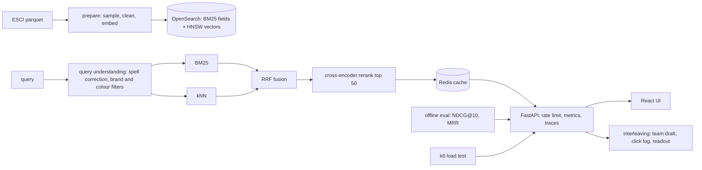

# Plan

Written before the code; updated where the build changed it.

## Goal

Product search over a real public catalog with lexical and vector retrieval fused by reciprocal rank
fusion, a cross-encoder reranker, query understanding (spell correction, brand and colour filters), an
offline evaluation with NDCG@10 and MRR on human relevance labels, an interleaving comparison between
rankers, a Redis cache, rate limiting, an SLO with an alert, k6 load tests, OpenTelemetry, and a React UI.

## Data

Amazon Shopping Queries Dataset (ESCI, Apache 2.0): 1.2 million products and 2.6 million query-product
judgments labelled Exact, Substitute, Complement or Irrelevant by human annotators. We use the US locale
and the dataset's "small version" split: the catalog indexed locally is every product judged for the
sampled queries plus random distractors (target about 250 thousand products); the evaluation set is a
fixed sample of test queries with all their judgments. Files are downloaded by a checked script with
sha256 pins; nothing from the dataset is committed except the sampled query ids.

## Architecture

- **Retrieval:** OpenSearch 2.19, one index, `multi_match` over title, brand, bullets and description for
  BM25; the k-NN plugin (HNSW, cosine) over all-MiniLM-L6-v2 embeddings of title plus bullets. Hybrid =
  reciprocal rank fusion of the two lists (k = 60). Reranker: cross-encoder/ms-marco-MiniLM-L-6-v2 on the
  fused top 50. Both models run on CPU with PyTorch so the container and CI match the laptop.
- **Query understanding:** SymSpell over the catalog vocabulary for spelling; brand and colour terms in
  the query become filters when they match the catalog's brand and colour values; explicit filters from
  the UI are honoured as well.
- **Eval (ADR 0002):** gains E = 1, S = 0.1, C = 0.01, I = 0 as in the ESCI paper; NDCG@10 and MRR@10
  (first Exact) per ranker variant: BM25, kNN, hybrid, hybrid with rerank. Judged-only metrics; unjudged
  retrieved products count as irrelevant, which is stated.
- **Interleaving (ADR 0003):** team-draft interleaving of two rankers per query; clicks from the UI are
  logged with the team that owned the result; a readout gives per-query wins, the win rate with a
  binomial interval, and the number of queries needed. A simulated click model over the labels produces
  the same readout offline so the method is demonstrated without real traffic.
- **Serving:** FastAPI, Redis cache keyed by the normalised query, filters and ranker; per-key rate
  limit; request ids and JSON logs; Prometheus metrics by ranker; OpenTelemetry traces; SLO p99 under
  200 ms for hybrid without rerank at the stated rate, with an alert, and the reranked variant measured
  separately.
- **UI:** React with Vite: query box with suggestions from the spell corrector, facets for brand and
  colour, ranker selector, interleaving mode, click logging. Playwright end-to-end test.
- **Deployment:** Terraform for an Oracle Cloud free-tier ARM VM running the Compose stack from GHCR
  images (OpenSearch needs memory that free container platforms do not give). Not applied without the
  owner's account.

## Numbers to produce

- NDCG@10 and MRR@10 per ranker variant on the labelled query sample.
- p50, p95 and p99 latency at a stated request rate from k6 on one machine, for hybrid and for hybrid
  with rerank, cache cold and warm.

## Milestones

1. Data preparation, OpenSearch index with vectors, BM25 and kNN retrieval, RRF.
2. Query understanding, reranker, offline eval over the variants.
3. API with cache, rate limit, metrics, traces; interleaving and click log; k6 load test.
4. React UI with end-to-end test.
5. Observability, Compose, Terraform, CI, documentation.
